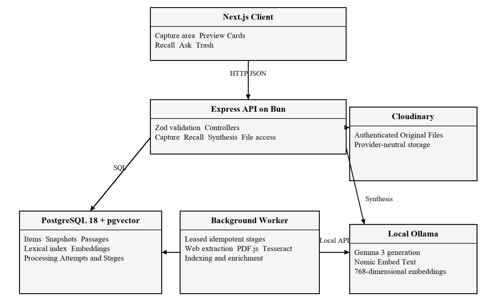
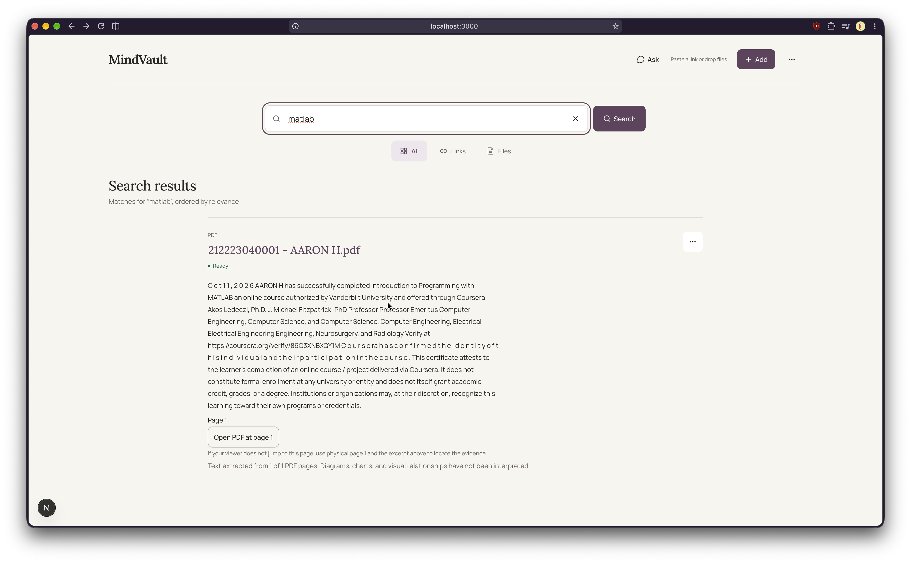

## Title of the Project

**MindVault: A Source-Agnostic Personal Knowledge Management System**

MindVault captures and organizes information from webpages and PDFs, then helps users find relevant evidence through conceptual search and grounded answers.

## About

MindVault is a personal knowledge management system designed to make saved information useful over time. It captures public textual webpages and PDFs, processes them into searchable Knowledge Items, and retains their source evidence.

Traditional note-taking and bookmarking systems often rely on users to maintain folders, tags, or precise search terms. MindVault reduces that manual work by automatically organizing captured material with topic tags and recognition summaries. Its hybrid retrieval combines PostgreSQL text search with vector search, helping users find relevant Knowledge Items even when they remember only the general idea.

For PDFs, MindVault preserves physical page references and reports when extraction coverage is partial. Search results show supporting excerpts, while the Ask feature generates answers grounded in retained evidence and provides citations.

## Features

- Captures public textual webpages and PDFs as durable Knowledge Items.
- Processes sources into Preview Cards, Source Snapshots, indexed Passages, Recognition Summaries, and Topic Tags.
- Supports conceptual and exact-term recall through hybrid text and vector retrieval.
- Provides grounded synthesis with citations to supporting evidence.
- Preserves physical page provenance for PDF evidence.
- Discloses partial PDF extraction coverage, including bounded OCR gaps.
- Uses local Ollama models for generation and embeddings.
- Tracks Knowledge Item availability as Processing, Ready, Unsupported, or Needs attention.

## Requirements

- **Runtime:** Bun.
- **Backend:** Node.js-compatible TypeScript runtime with Express.
- **Frontend:** Next.js.
- **Database:** PostgreSQL 18 with the pgvector extension.
- **Object storage:** Cloudinary, accessed through a provider-neutral Original File storage boundary.
- **AI models:** Local Ollama with Gemma 3 for generation and Nomic Embed Text for embeddings.
- **Validation:** Zod.
- **Development tools:** Git and an IDE such as Visual Studio Code.
- **Optional container setup:** Docker and Docker Compose for running PostgreSQL with pgvector.

## System Architecture

## Output

#### Output 1 – Home Page

#### Output 2 – Search / Recall Results

#### Output 3 – Ask / Grounded Synthesis

## Results and Impact

MindVault provides a source-agnostic way to keep useful information and retrieve it later without depending on manually maintained folders or exact search terms. Hybrid retrieval supports both conceptual and exact-term searches, while grounded answers make the supporting evidence visible through citations.

For retained PDFs, page references connect results to their physical source locations, and Extraction Coverage notices help users understand when extracted evidence may be incomplete. MindVault establishes a foundation for broader source adapters and a lightweight browser capture client.

## Articles published / References

1. L. Diao, M. Zuo, and Q. Liu, “AI-Assisted Knowledge Classification and Search,” 2009.
2. L. Ju, J. Zhao, et al., “Agentic Deep Search with Automatic Metadata Extraction,” 2025.
3. P. Daftari, K. Patel, et al., “Hybrid BM25 and Vector Retrieval Fused via Reciprocal Rank Fusion,” 2026.
4. R. Tang, C. Zhu, et al., “LLM-Based Tag Recall, Generation, and Confidence Calibration,” 2025.
